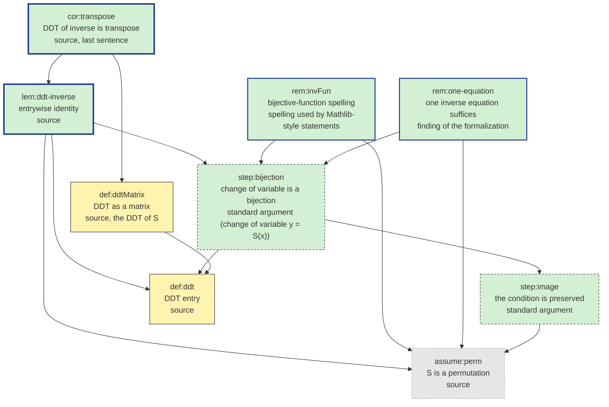

# CHAIN — DdtInverse: the proof chain of "Lemma (DDT of the inverse S-box)", for the reader to confirm

Target: `lem:ddt-inverse` (the user's statement of 2026-11-01, no paper; quoted verbatim in README.md).
Read the table from the target down to the definitions. Every row is one thing the proof relies
on; `uses` are the rows it relies on directly. The chain was written before the Lean file and
re-checked against it afterwards (`chain_check.py`).

## Nodes

| id | kind | title | statement | uses | where | implicit | lean | status |
|---|---|---|---|---|---|---|---|---|
| cor:transpose | theorem | DDT of inverse is transpose | "In words: the DDT of S^{-1} is the transpose of the DDT of S", as matrices | lem:ddt-inverse, def:ddtMatrix | source, last sentence | — | DdtInverse.ddtMatrix_symm | proved |
| lem:ddt-inverse | theorem | entrywise identity | For all a, b: #{x : S(x ⊕ a) ⊕ S(x) = b} = #{y : S^{-1}(y ⊕ b) ⊕ S^{-1}(y) = a} | step:bijection, def:ddt, assume:perm | source | none beyond the inverse equations | CipherLean.ddt_symm | proved |
| rem:invFun | lemma | bijective-function spelling | The lemma with S a bijective function and S^{-1} = Function.invFun S | step:bijection, assume:perm | spelling used by Mathlib-style statements | — | DdtInverse.ddt_invFun | proved |
| rem:one-equation | lemma | one inverse equation suffices | On a finite set, T ∘ S = id alone implies S ∘ T = id, so the lemma holds for any left inverse T | step:bijection, assume:perm | finding of the formalization | finiteness of F_2^n | DdtInverse.ddt_eq_ddt_of_leftInverse | proved |
| step:bijection | step | change of variable is a bijection | x ↦ S(x) sends {x : S(x⊕a)⊕S(x)=b} into {y : S^{-1}(y⊕b)⊕S^{-1}(y)=a}, y ↦ S^{-1}(y) sends it back, and the two maps are mutually inverse; hence equal cardinalities | step:image, def:ddt | standard argument (change of variable y = S(x)) | — | CipherLean.ddt_eq_ddt_of_inverse | proved |
| step:image | step | the condition is preserved | If S(x⊕a)⊕S(x) = b then S(x)⊕b = S(x⊕a), hence S^{-1}(S(x)⊕b) ⊕ S^{-1}(S(x)) = (x⊕a)⊕x = a; only S^{-1} ∘ S = id is used | assume:perm | standard argument | about the counted condition only, not the count | CipherLean.image_cond | proved |
| def:ddt | def | DDT entry | #{x ∈ F_2^n : S(x ⊕ a) ⊕ S(x) = b}, an unnormalized count, defined for every function S | — | source | a, b may be zero | CipherLean.ddt | stated |
| def:ddtMatrix | def | DDT as a matrix | the table (a, b) ↦ DDT entry, rows = input difference, columns = output difference | def:ddt | source, "the DDT of S" | — | CipherLean.ddtMatrix | stated |
| assume:perm | assumption | S is a permutation | "Let S be a permutation of F_2^n and S^{-1} its inverse": S bijective, S^{-1} its two-sided inverse | — | source | n = 0 allowed; on F_2^n one of the two inverse equations implies the other | Equiv.Perm | assumed |

`kind`: theorem · lemma · step · def · external · assumption. `uses`: comma-separated ids. `lean`: the declaration
that discharges the row (library lemmas allowed). `status`: pending · stated · proved · cited · assumed. Cells are
short; the longer explanations are in the Notes below, keyed by row id.

## Notes (by row id)

- `step:bijection`: the two maps `x ↦ S(x)` and `y ↦ S^{-1}(y)` are mutually inverse between the two counted
  sets, so `Finset.card_nbij'` gives the equality of the counts; only `S^{-1} ∘ S = id` is used for the first
  direction and `S ∘ S^{-1} = id` for the second (`CipherLean.ddt_eq_ddt_of_inverse`).
- `rem:one-equation`: on a finite type `Finite.injective_iff_surjective` turns a left inverse into a two-sided
  one, so the lemma holds for any `T` with `T ∘ S = id`; this is a finding of the formalization, not a claim of
  the source.
- `assume:perm`: `Equiv.Perm` carries both inverse equations (`S.symm_apply_apply`, `S.apply_symm_apply`); the
  bijective-function spelling uses Mathlib's noncomputable `Function.invFun`.

## External results

None: the source gives no proof and cites nothing; the argument is the standard change of variable.

## Implicit hypotheses found

- None is needed beyond "S^{-1} is the inverse of S"; the counterexamples `toy_not_symmetric` and
  `toy_id_fails` show that hypothesis cannot be dropped.
- On the finite set F_2^n the two inverse equations are not independent (`rem:one-equation`).

## Questions for the reader

- Is n = 0 meant to be excluded? The formal statement allows it (the lemma holds trivially there).

## Roadmap

End S: self-contained — every row proved here with standard axioms; reached on 2026-11-01.

| piece | title | rows | route | size | status | actual |
|---|---|---|---|---|---|---|
| A | the lemma, its spellings and the matrix form | cor:transpose, lem:ddt-inverse, rem:invFun, rem:one-equation, step:bijection, step:image, def:ddt, def:ddtMatrix | prove here | 1 session (nine rows, no computational case; the toy is one `decide` on 64 pairs) | done 2026-11-01 | 1 session; `Main.lean` 99 lines after the promotion of the four spellings into the library |
| hyp | the lemma's hypothesis | assume:perm | hypothesis | — | — | |

## Dependency graph

`chain_graph.py` writes `CHAIN.tex` (TikZ) and compiles `CHAIN.pdf` (border = kind of row, fill = status,
legend with the counts and the roadmap's progress); the mermaid version below is kept in sync by the same script.

<!-- chain-graph:begin -->

<!-- chain-graph:end -->
